# Job-Copilot

A personal job-search assistant that runs on your own computer. Tell it what you did in plain English, or fill in forms, and it keeps track of your applications, follow-ups, recruiters, job descriptions, résumés, interview prep and study plan, then reminds you when something is due.

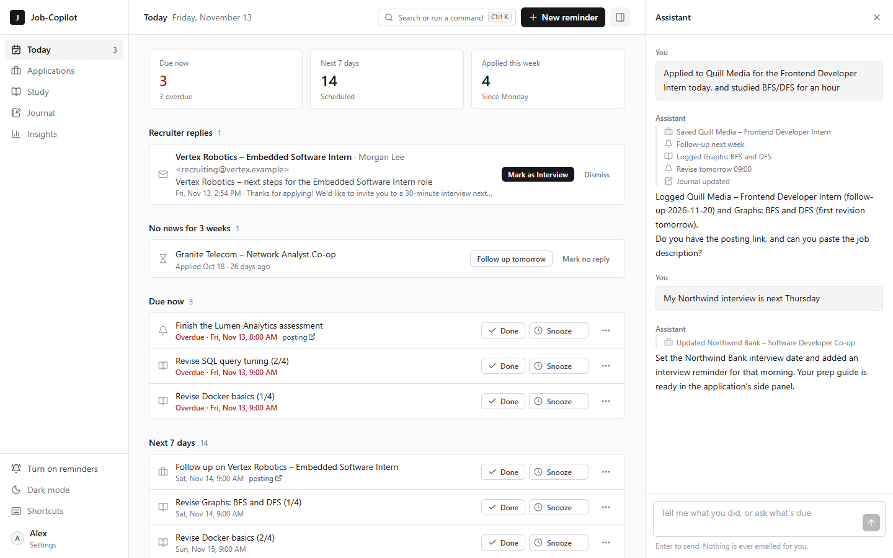

> **You:** Applied to Quill Media for the Frontend Developer Intern today, and studied BFS/DFS for an hour
>
> **Job-Copilot:** Logged Quill Media – Frontend Developer Intern (follow-up in a week) and Graphs: BFS and DFS (first revision tomorrow). Do you have the posting link, and can you paste the job description?

*All screenshots use made-up demo data.*

---

## Index

1. [What it does](#what-it-does)
2. [Quick start](#quick-start)
3. [Setup in detail](#setup-in-detail)
   - [What you need](#what-you-need)
   - [Get a Gemini API key](#get-a-gemini-api-key)
   - [Create the `.env` file](#create-the-env-file)
   - [Connect your Google account (optional)](#connect-your-google-account-optional)
   - [All settings in `server/.env`](#all-settings-in-serverenv)
4. [Using the app](#using-the-app)
   - [Today](#today)
   - [Applications: list and board](#applications-list-and-board)
   - [The application panel](#the-application-panel)
   - [Job description and résumé](#job-description-and-résumé)
   - [Interview prep guide](#interview-prep-guide)
   - [Résumé folder](#résumé-folder)
   - [Recruiters and messages](#recruiters-and-messages)
   - [Study plan](#study-plan)
   - [Journal](#journal)
   - [Insights](#insights)
   - [Settings](#settings)
   - [The assistant (chat)](#the-assistant-chat)
   - [Search and keyboard shortcuts](#search-and-keyboard-shortcuts)
   - [Dark mode and phone layout](#dark-mode-and-phone-layout)
5. [How reminders work](#how-reminders-work)
6. [Your data, privacy and backups](#your-data-privacy-and-backups)
7. [Troubleshooting](#troubleshooting)
8. [For developers](#for-developers)
   - [How it works](#how-it-works)
   - [Project layout](#project-layout)
   - [Tests](#tests)

---

## What it does

| | |
|---|---|
| **Applications** | Track every job: company, role, link, date applied, status (Applied → Online assessment → Interview → Offer, or Rejected / No reply). Each status change is kept with a note. Search, sort, or drag cards on a board. |
| **Job descriptions** | Save the JD on each application (paste it, or fetch it from the posting link) so you still have it after the posting comes down. |
| **Résumés** | Keep the exact résumé you sent for each job (PDF or Word), reuse it for another application, and keep a base résumé in Settings. |
| **Interview prep** | When an application reaches Interview, get a prep guide built from the JD and your résumé: topics to study and why, likely questions, and gaps in your résumé. Tick topics to add them to your study plan with reminders before the interview. |
| **Follow-ups and reminders** | A follow-up 7 days after you apply, interview-day reminders, your own reminders, and spaced revision for what you study (1, 3, 7 and 21 days later). |
| **Recruiters** | Save recruiters and referrals, write or draft messages. **Nothing is ever sent for you.** |
| **Study plan** | Log study sessions, keep notes, and see what to revise next. |
| **Journal** | A daily log of what you did, written by the assistant or by you. |
| **Insights** | Applications per week, how far they got, response rate, time to a reply, and your streak. |
| **Google (optional)** | Reminders as Google Calendar events, a morning digest from your Gmail, drafts saved into Gmail, and recruiter replies noticed in your inbox. |
| **Chat** | Everything above can be done by telling the assistant in plain English, powered by Google Gemini. |

It is a **single-user app with no sign-in**: it runs on your computer, for you.

---

## Quick start

From the `Job-Copilot` folder:

```bash
npm start
```

The first time, this creates `server/.env` and asks you to paste your [Gemini API key](#get-a-gemini-api-key) into it. Run `npm start` again and it:

- checks you have Node 22.13+,
- installs the server and client dependencies (first run only),
- starts the server (:5000) and the client (:5173) together, with their output labelled `[server]` and `[client]`,
- opens **http://localhost:5173** in your browser.

**Ctrl+C** (or closing the window) stops both. If either one crashes, the other is stopped too, so nothing is left running in the background. If Job-Copilot is already running, `npm start` just opens it in the browser instead of starting a second copy. No account, no login.

### Desktop shortcut (Windows)

```bash
npm run shortcut
```

This puts a **Job-Copilot** icon on your desktop and in the Start menu. To keep it on the taskbar, right-click either one and choose **Pin to taskbar** (on the desktop icon, it's under **Show more options**). Windows doesn't let a script pin it for you. Double-click it to start the app (it runs `Start Job-Copilot.cmd`, which is the same as `npm start`); close its window to stop it. Double-clicking while it's already running just opens the browser. You can also double-click `Start Job-Copilot.cmd` in the project folder directly.

<details>
<summary>Running the server and client separately</summary>

```bash
# 1. Server
cd server
cp .env.example .env          # then open .env and paste your GEMINI_API_KEY
npm install
npm run dev                   # http://localhost:5000

# 2. Client (in a second terminal)
cd client
npm install
npm run dev                   # http://localhost:5173
```

Windows (PowerShell): use `copy .env.example .env` instead of `cp`.
</details>

---

## Setup in detail

### What you need

- **Node.js 22.13 or newer** (it uses Node's built-in SQLite, so there is no database to install). Check with `node --version`. Download from [nodejs.org](https://nodejs.org/).
- **A Gemini API key** (free tier available), for the assistant and prep guides.
- **Optional:** a Google account and a Google Cloud project, if you want Calendar and Gmail.

### Get a Gemini API key

The assistant, prep guides and message drafts use Google's Gemini models.

1. Go to **[Google AI Studio → API keys](https://aistudio.google.com/apikey)** and sign in with your Google account.
2. Click **Create API key**. Pick an existing Google Cloud project or let it create one.
3. Copy the key (it starts with `AIza…`).
4. Paste it into `server/.env`:

   ```env
   GEMINI_API_KEY=AIzaSy...your-key...
   ```

Keep this key private: don't commit `.env` (it is already in `.gitignore`) or share screenshots of it. The server will not start without it.

### Create the `.env` file

All server settings live in `server/.env`. Start from the example:

```bash
cd server
cp .env.example .env
```

The only required value is `GEMINI_API_KEY`. Everything else has a sensible default; see [All settings](#all-settings-in-serverenv). After changing `.env`, restart the server (`npm run dev` restarts on file changes, but not on `.env` changes).

The client needs no `.env` when the server runs on port 5000. If the server is elsewhere, create `client/.env` with:

```env
VITE_API_URL=http://localhost:5000
```

### Connect your Google account (optional)

Job-Copilot works fully without Google. Connecting Google adds:

| Service | What it does | Google permission |
|---|---|---|
| **Google Calendar** | Every reminder becomes a 30-minute event with the job link and recruiter details. Done removes it; snooze moves it. | See and edit calendar events |
| **Daily digest from your Gmail** | A morning email to **you** with what's due and applications with no news for 3+ weeks. | Send email on your behalf (only ever to you) |
| **Save drafts to Gmail** | Puts outreach messages into your Gmail **Drafts** folder, addressed and ready. You press Send yourself. | Manage drafts |
| **Notice recruiter replies** | Every 15 minutes, looks for mail from recruiters you saved and suggests a status on Today. Only the sender, subject and preview are kept. | Read email |

**No setup at all:** each reminder's **⋯** menu has **Add to Google Calendar**, which opens Google Calendar's own "new event" page already filled in, and messages have **Open in Gmail**. Those need nothing below.

**For automatic sync**, Google needs you to register a small app of your own, once (about five minutes, free; nobody else sees it). The easiest way is from the app: **Settings → Google Calendar and Gmail** walks you through it with a direct link for each step and a Copy button for the redirect URI. You paste the Client ID and secret there (they're stored encrypted), with no `.env` editing and no restart. Then tick the services you want and click **Connect Google** once. Google asks for all of them on one screen.

The same steps in detail, if you prefer to follow them here or put the client in `.env`:

#### Step 1: Create a Google Cloud project

1. Open **[Google Cloud Console](https://console.cloud.google.com/)** and sign in.
2. Use the project picker at the top → **New project**. Name it e.g. `job-copilot` → **Create**, then select it.

#### Step 2: Turn on the APIs

1. Go to **APIs & Services → Library**.
2. Search for **Google Calendar API** → **Enable**.
3. Search for **Gmail API** → **Enable**.

Pick the plain APIs: Google tags them **"Google Enterprise API"**, which is only a category; they are free. Skip the entries with **MCP** in the name (for example **Gmail MCP API**, `gmailmcp.googleapis.com`): those let AI tools such as Claude Desktop reach Gmail, and Job-Copilot doesn't use them. To be sure, open them directly: [Gmail API](https://console.cloud.google.com/apis/enableflow?apiid=gmail.googleapis.com) (`gmail.googleapis.com`) and [Google Calendar API](https://console.cloud.google.com/apis/enableflow?apiid=calendar-json.googleapis.com) (`calendar-json.googleapis.com`).

Both are free: there is no charge and no billing account is needed, only daily usage limits far above what one person uses.

#### Step 3: Set up the consent screen

Google calls this the **OAuth consent screen** (in newer consoles: **Google Auth Platform**).

1. Go to **APIs & Services → OAuth consent screen** (or **Google Auth Platform → Branding**) → **Get started**.
2. **App name:** `Job-Copilot`. **User support email:** your email.
3. **Audience:** choose **External**.
4. **Contact information:** your email → **Create**.
5. Under **Audience → Test users**, click **Add users** and add **your own Google email**. Only test users can connect while the app is in testing.

You don't need to add scopes here; the app asks for each one when you click Connect.

#### Step 4: Create the OAuth client

1. Go to **APIs & Services → Credentials** (or **Google Auth Platform → Clients**) → **Create credentials → OAuth client ID**.
2. **Application type:** **Web application**. **Name:** `Job-Copilot local`.
3. Under **Authorized redirect URIs**, click **Add URI** and enter exactly:

   ```
   http://localhost:5000/auth/google/callback
   ```

4. Click **Create**. Copy the **Client ID** and **Client secret**.

#### Step 5: Paste them into Settings (or `server/.env`)

Paste the Client ID and secret into **Settings → Google Calendar and Gmail → Save**. That's all: no restart.

Or put them in `server/.env` instead (these take priority over Settings):

```env
GOOGLE_CLIENT_ID=1234567890-abc123.apps.googleusercontent.com
GOOGLE_CLIENT_SECRET=GOCSPX-...
GOOGLE_REDIRECT_URI=http://localhost:5000/auth/google/callback
GOOGLE_CALENDAR_ID=primary
```

and restart Job-Copilot.

#### Step 6: Connect in the app

1. Open **Settings** (press `6`) → **Google Calendar and Gmail**.
2. Tick the services you want and click **Connect Google**. Google opens and asks for all of them on one screen.
3. You will see **"Google hasn't verified this app"**: that's expected for your own app in testing. Click **Continue** (sometimes under **Advanced → Go to Job-Copilot**).
4. Allow the permissions. You land back in Settings with the services marked **Connected**. If you untick one on Google's screen, it simply stays off.

To add another service later, tick it and connect again. **Disconnect** stops using a service; disconnecting the last one withdraws the app's access to your Google account. **Use a different one** (under the list) forgets a client pasted into Settings.

> **Note:** While your consent screen is in **Testing**, Google expires these connections after **7 days**. When that happens, Settings shows a warning and you click **Connect** again. To avoid it, publish the app (Audience → Publish app). The "Read email" permission then needs Google's review, so many people simply reconnect weekly.

### All settings in `server/.env`

| Setting | Default | What it does |
|---|---|---|
| `GEMINI_API_KEY` | (required) | Your Gemini API key. |
| `GEMINI_MODEL` | `gemini-3.5-flash-lite` | Which Gemini model to use. |
| `GEMINI_TIMEOUT_MS` | `30000` | How long to wait for Gemini before giving up. |
| `AGENT_MAX_TURNS` | `12` | Most tool-calling rounds the assistant may take for one message. |
| `PORT` | `5000` | Server port. If you change it, set `VITE_API_URL` in `client/.env` and update `GOOGLE_REDIRECT_URI`. |
| `CLIENT_ORIGIN` | `http://localhost:5173` | Where the client runs (comma-separate several). Requests from other websites are refused. |
| `APP_URL` | `http://localhost:5173` | Link used in calendar events and the digest email. |
| `USER_NAME` | | Your name, used to sign drafts. Can be changed in Settings. |
| `USER_PITCH` | | A sentence about you, so drafts are specific. Can be changed in Settings. |
| `APP_TIMEZONE` | `America/Toronto` | Timezone for every date and time ([list](https://en.wikipedia.org/wiki/List_of_tz_database_time_zones)). Can be changed in Settings. |
| `FOLLOW_UP_DAYS` | `7` | Days after applying before the follow-up reminder. |
| `REMINDER_HOUR` | `9` | Hour (0–23) when follow-ups, revisions and interview reminders come due. |
| `DIGEST_HOUR` | `9` | Hour the Gmail digest is sent. |
| `NUDGE_HOUR` | `20` | Hour of the evening "nothing logged today?" check-in. |
| `RESUME_FOLDER` | none | Folder where you save tailored résumés; can also be set in Settings. See [Résumé folder](#résumé-folder). |
| `DB_PATH` | `server/data/copilot.db` | Where the database file lives. |
| `GOOGLE_CLIENT_ID` | | From [Step 4](#step-4-create-the-oauth-client). Leave empty to skip Google. |
| `GOOGLE_CLIENT_SECRET` | | From Step 4. |
| `GOOGLE_REDIRECT_URI` | `http://localhost:5000/auth/google/callback` | Must match the URI in your OAuth client exactly. |
| `GOOGLE_CALENDAR_ID` | `primary` | Which calendar gets events (`primary` is your main one). |
| `APP_SECRET` | (generated) | Encrypts Google tokens in the database. If empty, one is generated into `server/data/secret.key`. |
| `HOST` | `loopback` | The server only listens on this computer. Don't change it unless something in front of the app handles sign-in. |
| `ALLOWED_HOSTS` | | Extra host names the server answers to (only needed when `HOST` is changed). |

---

## Using the app

The sidebar on the left switches views; the **Assistant** panel on the right can be shown or hidden (`A`). Each view's main action is the black button at the top right.

### Today


Your daily start page:

- **Due now / Next 7 days / Applied this week** at a glance.
- **New résumés in your folder**: tailored résumés found in your [résumé folder](#résumé-folder) that are waiting for you to pick the application.
- **Recruiter replies**: mail from saved recruiters (when Gmail reading is connected), with a suggested status. Click **Mark as Interview** (or pick another) or **Dismiss**. Nothing changes until you click.
- **No news for 3 weeks**: applications still on Applied after 21 days with nothing scheduled. **Follow up tomorrow** adds a reminder; **Mark no reply** closes it.
- **Due now** and **Next 7 days**: every reminder, with **Done**, **Snooze** (tomorrow / 3 days / next week), and **⋯** to edit or delete.
- **Logged today**: what's in today's journal.

### Applications: list and board

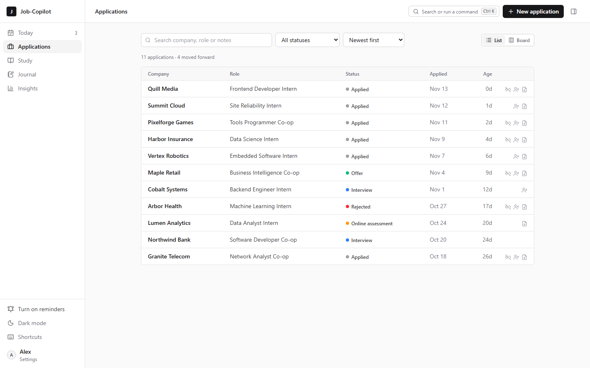

- **New application** (`N`): company, role, link, date, résumé (upload, or "same résumé as…" another application) and notes. A follow-up is scheduled automatically.
- **Search** company, role or notes; **filter** by status; **sort** by newest, oldest, company or last updated.
- Icons on a row show what's missing: no posting link, no recruiter saved, no job description.
- Click a row to open its [panel](#the-application-panel).

Switch to **Board** to see one column per status:

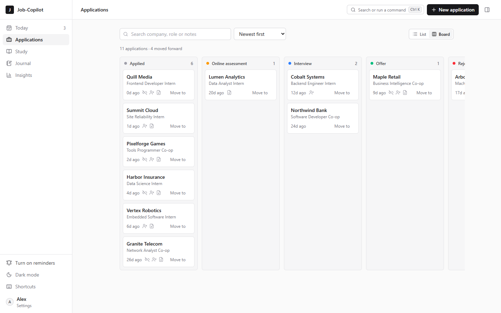

Drag a card to another column (or use **Move to** on the card). Moving to Interview, Offer or Rejected asks for an optional note, and the interview date; moving to Interview then offers a [prep guide](#interview-prep-guide).

### The application panel

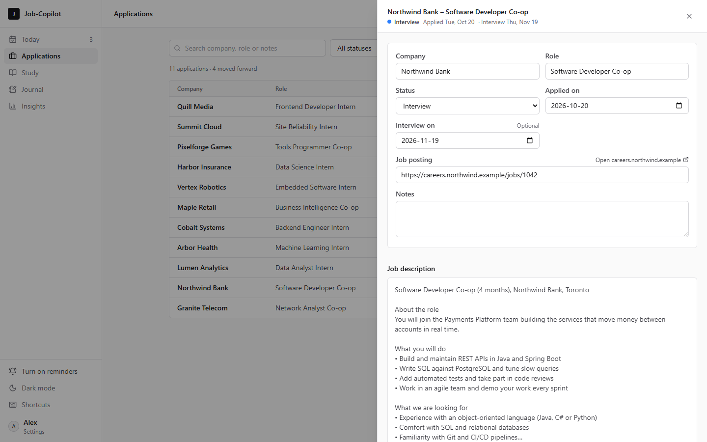

Everything about one application, all editable:

- **Details**: company, role, status, applied date, interview date, posting link, notes. Changing the status asks for a note that is kept in **Progress**. Changing the applied date moves the follow-up; setting the interview date adds an interview reminder.
- **Job description**, **Résumé sent**, **Interview prep guide** (see below).
- **Progress**: every status change with its date and note.
- **Recruiters & contacts**, **Messages**, **Reminders** for this application.
- **Delete application** at the bottom (asks first; it can't be undone).

### Job description and résumé

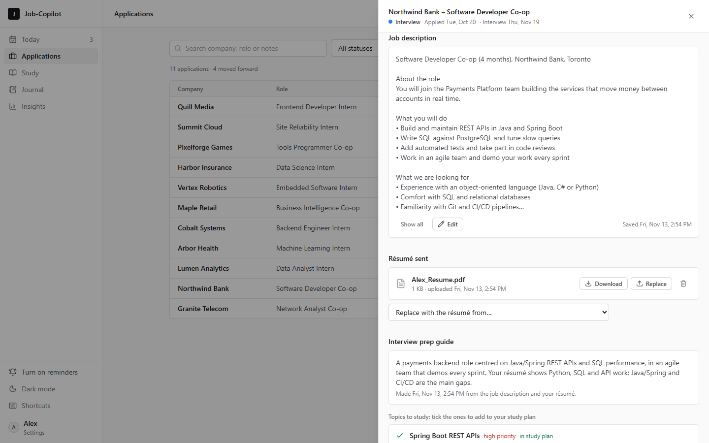

- **Job description:** **Paste description**, or **Fetch from link** to read it from the posting page. You check it before saving. Some job sites (Workday, for example) build the page in the browser and can't be fetched; paste those.
- **Résumé sent:** upload the PDF or Word file you sent, **Download** it later, **Replace** or remove it. **"Or use the same résumé as…"** copies the résumé from another application, for when you sent the same one twice. The text is read from the file for the prep guide.

### Interview prep guide

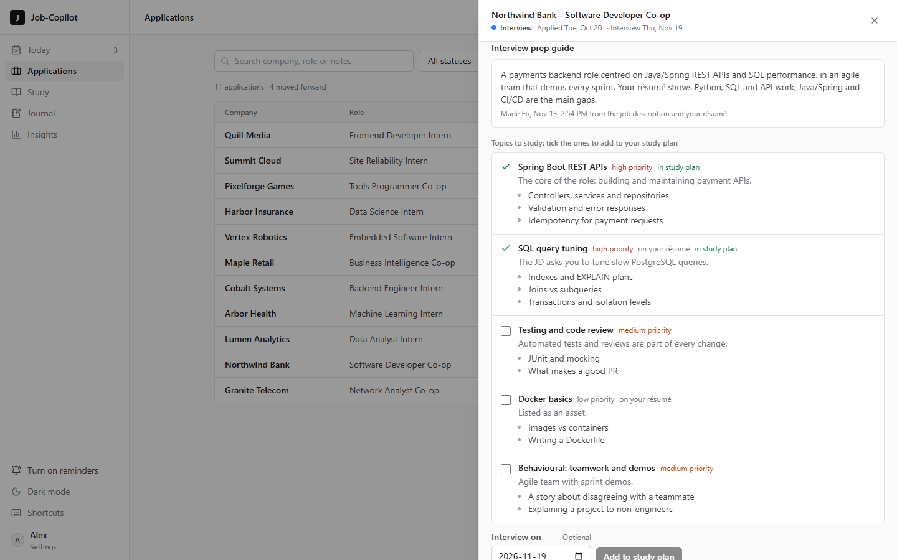

When an application moves to **Interview** (from the board, the panel, a recruiter reply or chat), Job-Copilot asks if you want a prep guide. It reads the job description and your résumé (the one on the application, else your base résumé from Settings) and gives you:

- a short summary of what the role cares about,
- **topics to study**, each with why it matters, what to cover, priority, and whether your résumé already shows it,
- **likely questions**, and **gaps**: things the JD asks for that your résumé doesn't show.

Tick topics, optionally set the interview date, and click **Add to study plan**. Each topic gets a "what to cover" plan in [Study](#study-plan) and a reminder to study it, spread over the days before the interview. If you change the JD or résumé later, the guide says so; **Make a new guide** keeps what you already added.

### Résumé folder

If you keep every tailored résumé in one folder, set it in **Settings → Résumé folder** and Job-Copilot will notice new files for you, so you never have to remember to upload them.

- Every minute (or when you click **Check now**, or ask the assistant "check my résumé folder") it looks at the PDF and Word files in the folder and one level of sub-folders, so one sub-folder per company works (`Shopify/Resume.pdf`). A file is picked up once it has stopped changing for a few seconds. Cover letters and transcripts are skipped.
- The first time a folder is set, the files already in it are noted but **not** offered, so an old folder does not fill your Today page. Only files saved after that are.
- New files appear on **Today** under *New résumés in your folder*, each with its best guesses. The match comes from the company and role words in the **file name and its sub-folder name** and how close the file's date is to the application date (no AI involved). Click **Attach to …**, or **Replace résumé for …** when that application already has one, pick **Another application…**, start a **New application** from the file, or **Ignore** it.
- **Attach automatically when sure** (off by default): when the file name names exactly one application that has no résumé yet, the file is attached on its own and a notice offers **Undo**. Anything less certain waits for your click.
- A file that you already uploaded by hand is recognised and not offered again; a renamed file is not offered again; a file saved with new content is offered as a replacement.
- Your folder is only read. Job-Copilot never moves, renames, edits or deletes anything in it.

### Recruiters and messages

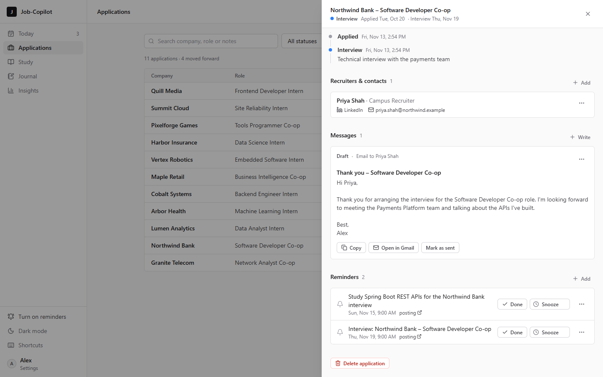

- **Add** a recruiter or referral: name, title, email, LinkedIn. **⋯** to edit or delete.
- **Write** a message yourself, or ask the assistant to draft one ("draft a thank-you email to Priya"). Drafts are **never sent** by the app.
- **Copy**, **Open in Gmail** (opens a pre-filled compose window), or **Save to Gmail Drafts** (if connected). After you send it yourself, click **Mark as sent**.

### Study plan

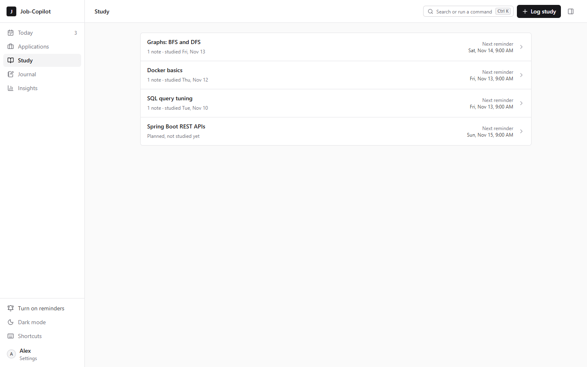

- **Log study** (`S`): a topic, what you covered, and the date. A new topic gets revision reminders after **1, 3, 7 and 21 days**.
- Click a topic to see its plan, reminders and notes:

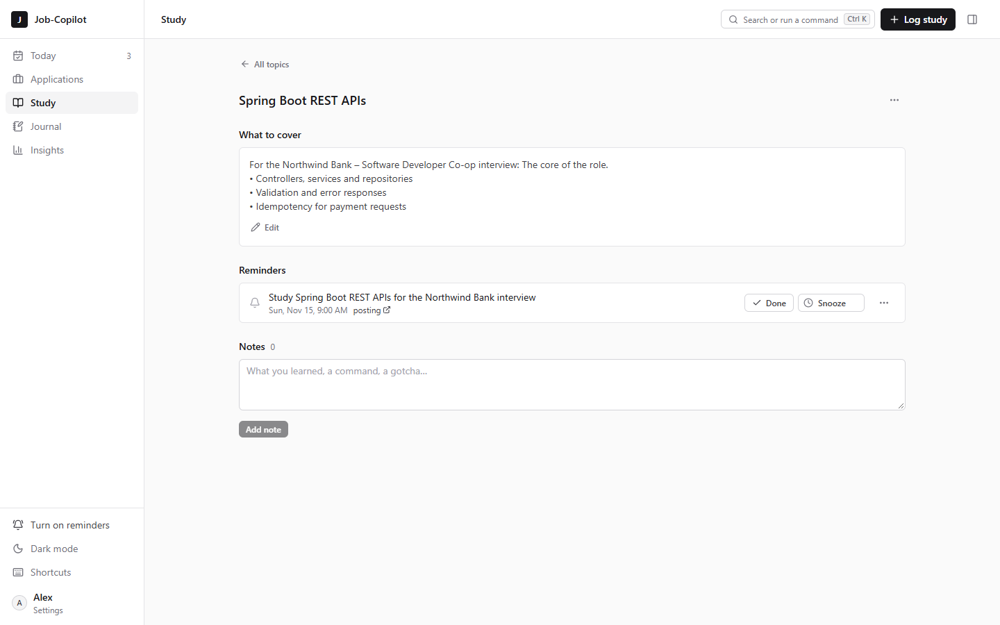

- **What to cover**: a plan for the topic (filled in by prep guides, or written by you).
- **Notes**: add, edit or delete. **⋯** at the top renames or deletes the topic.

### Journal

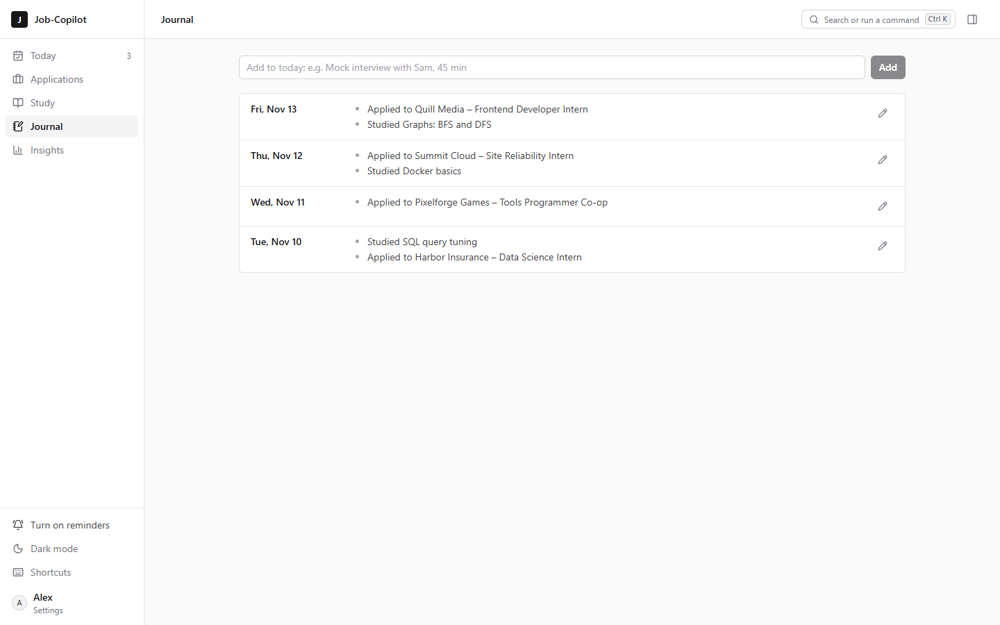

One entry per day. Type a line and **Add** (or press `J` from anywhere), or let the assistant log what you tell it. The pencil edits a whole day.

### Insights

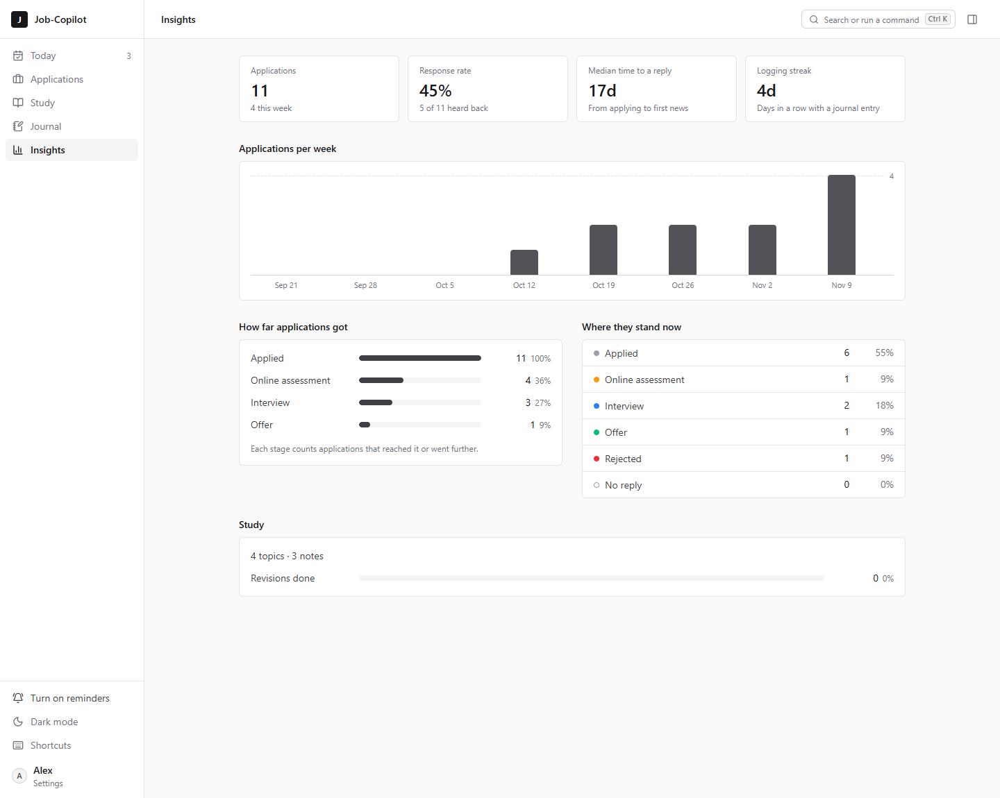

Applications per week, response rate, median time to a reply, your logging streak, how far applications got (online assessment → interview → offer), where they stand now, and study progress.

### Settings

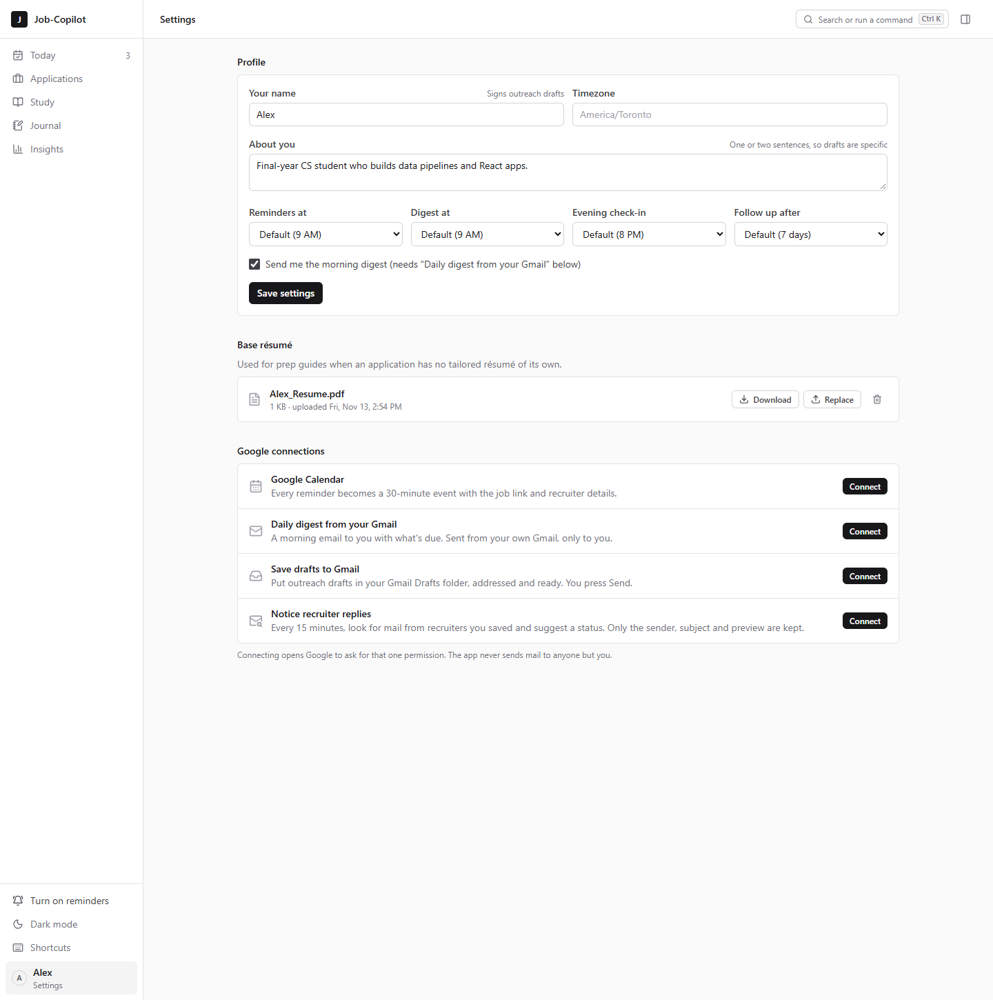

- **Profile**: your name, a sentence about you (used in drafts), timezone, and the hours for reminders, the digest and the evening check-in. Empty fields use the defaults from `.env`.
- **Base résumé**: used by prep guides when an application has no résumé of its own.
- **Résumé folder**: the folder where you save your tailored résumés (see [below](#résumé-folder)).
- **Google Calendar and Gmail**: a guided setup the first time, then tick services and connect them at once, or disconnect each one (see [setup](#connect-your-google-account-optional)).

### The assistant (chat)

Open it with the panel button at the top right, `A`, or `/` to jump straight to typing. Write the way you'd text a friend; one message can hold several things.

| You say | It does |
|---|---|
| "Applied to RBC Amplify today, here's the link …" | Logs the application, schedules the follow-up, asks for the JD and recruiter. |
| "Same résumé as my other Qualcomm application" | Attaches that résumé. |
| "Got an interview with Shopify on Nov 19" | Moves it to Interview, sets the date, adds the reminder, offers a prep guide. |
| "Yes, make the guide. Add the first two topics." | Builds the guide and adds those topics to your study plan. |
| "The recruiter is Priya Shah, priya@northwind.com" | Saves the contact and offers to draft a message. |
| "Studied Docker networking for an hour" | Logs it and schedules revisions. |
| "Move the RBC reminder to Friday 3pm" / "Delete it" | Edits or deletes the reminder. |
| "What's due this week?" | Lists your reminders. |

Under each reply you see what it actually saved. When a date is vague ("in November") it asks which day and corrects the date when you answer. It can't delete applications (use the panel) and never sends email.

### Search and keyboard shortcuts

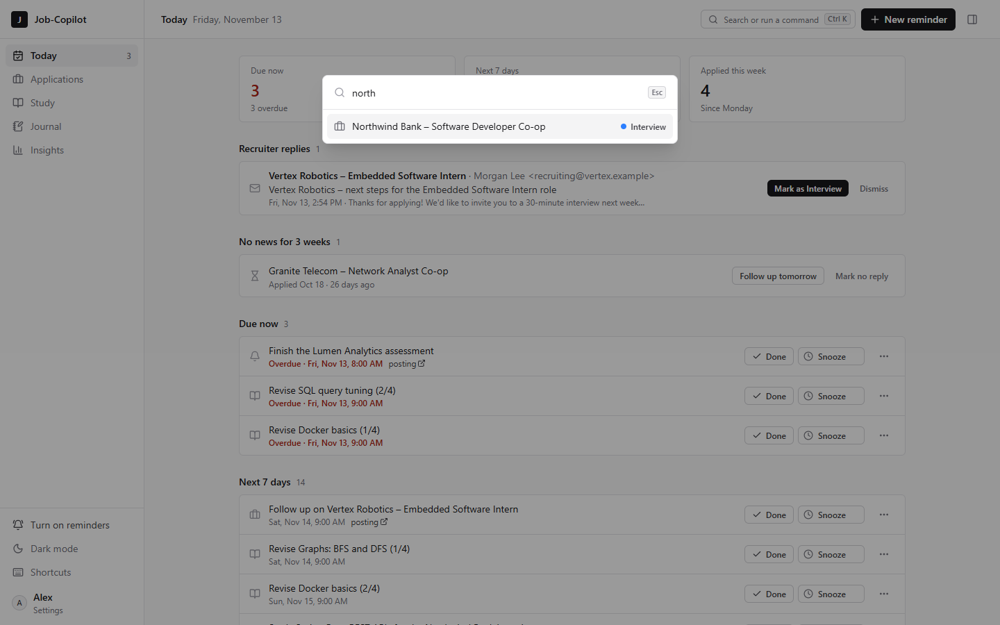

`Ctrl+K` opens a search box: type to jump to any application or run a command.

| Key | Action |
|---|---|
| `Ctrl+K` | Search applications or run a command |
| `1`–`6` | Today, Applications, Study, Journal, Insights, Settings |
| `/` | Write to the assistant |
| `A` | Show or hide the assistant |
| `N` | New application |
| `R` | New reminder |
| `S` | Log a study session |
| `J` | Add a line to today's journal |
| `?` | Show the shortcut list |
| `Esc` | Close a dialog or panel |

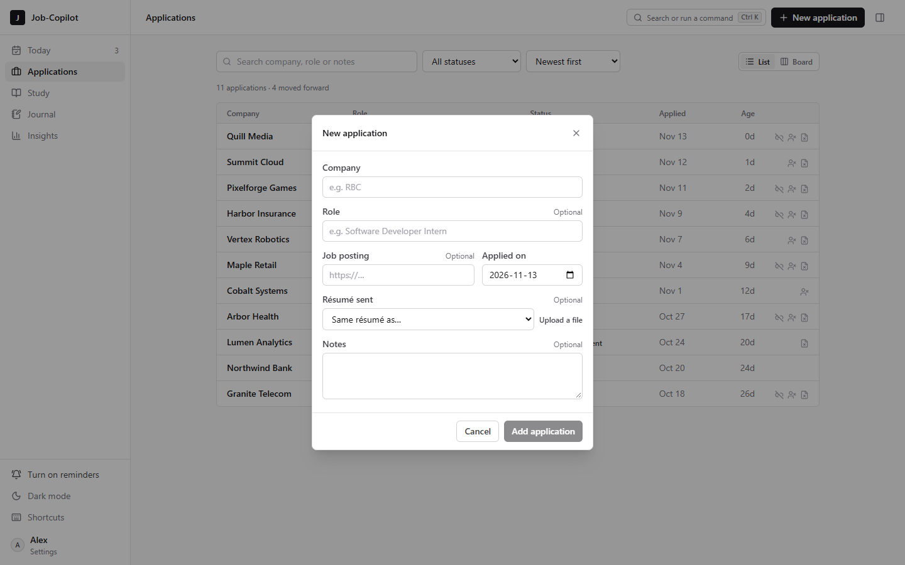

### Dark mode and phone layout

**Dark mode** is in the sidebar (or `Ctrl+K` → "Switch to dark mode"); it follows your system until you choose.

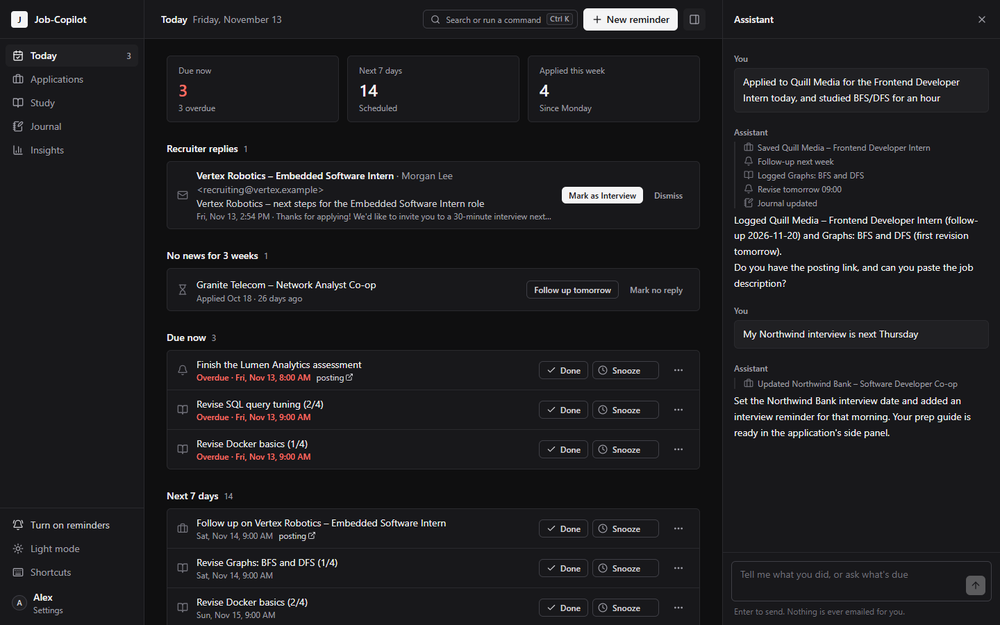

On a narrow window the sidebar becomes a bottom bar and the assistant opens full screen.

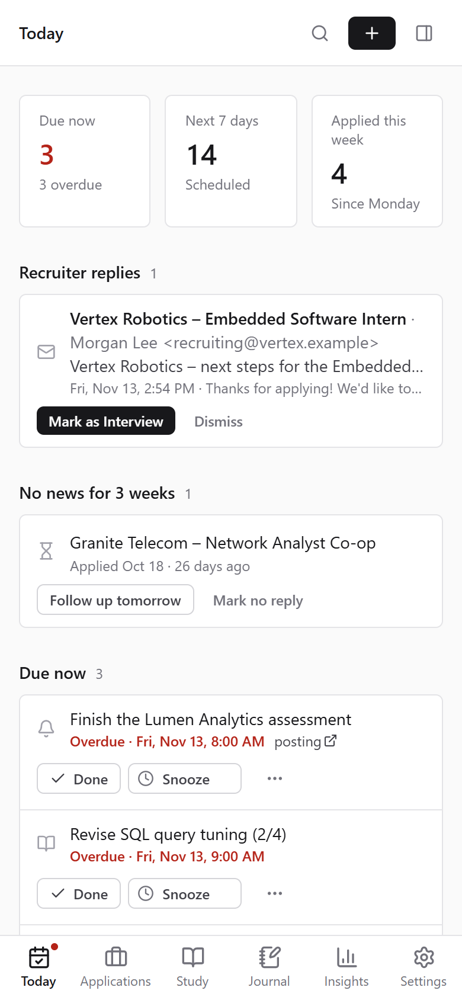

Click **Turn on reminders** in the sidebar once to allow desktop notifications when something comes due.

---

## How reminders work

| Reminder | When | What changes it |
|---|---|---|
| **Follow-up** | 9:00, 7 days after you apply | Moves when you change the applied date. Cancelled when the status changes; comes back if you set it back to Applied. Applications logged more than two weeks late get none. |
| **Interview** | 9:00 on the interview day | Follows the interview date; removed if the application is rejected, closed or the date is cleared. |
| **Revision** | 9:00, 1/3/7/21 days after a study session | Studying the topic again after the cycle starts a new one. |
| **Prep study** | Spread over the days before the interview | Added from the prep guide. |
| **Your own** | Whenever you choose | Edit, snooze or delete any time. |

Reminders appear on Today, as a desktop notification when due (with the browser open), in the Gmail digest, and as Google Calendar events if connected. Reminders that came due while the server was off show up as soon as it starts. Times use the timezone from Settings.

---

## Your data, privacy and backups

- **Everything is stored locally** in `server/data/copilot.db` (SQLite), including résumé files. Nothing is uploaded anywhere except:
  - the text you send to the assistant, job descriptions and résumé text for prep guides, which go to **Google Gemini**;
  - Calendar and Gmail requests, if you connect them.
- **No sign-in, so it stays on your computer:** the server only listens on `localhost`, refuses requests addressed to any other host name, and refuses changes from other websites.
- Google tokens are stored **encrypted** with the key in `server/data/secret.key` (or `APP_SECRET`). Keep that file with the database; without it you'd need to reconnect Google.
- **Back up** by copying `server/data/` while the server is stopped. To restore, put the files back.
- `server/data/` and `.env` are in `.gitignore`, so your data and keys aren't committed.

---

## Troubleshooting

| Problem | Fix |
|---|---|
| `GEMINI_API_KEY is missing` | Create `server/.env` from `.env.example` and add your key. |
| `node:sqlite` errors on start | Update Node to 22.13 or newer. |
| The page says "Can't reach the server" | Start the server (`cd server && npm run dev`) and keep it running on port 5000. |
| The assistant says it hit an error | Check the key at [AI Studio](https://aistudio.google.com/apikey); you may have hit the free-tier limit. Try again in a minute. |
| Settings says "Google isn't set up" | Add `GOOGLE_CLIENT_ID` and `GOOGLE_CLIENT_SECRET` to `server/.env` and restart. |
| Google shows `redirect_uri_mismatch` | The redirect URI in your OAuth client must be exactly `http://localhost:5000/auth/google/callback`. |
| Google shows "Access blocked" or "access_denied" | Add your email under **Test users** on the consent screen. |
| A connection stopped working after a week | Testing-mode apps expire after 7 days: click **Connect** again in Settings. |
| "Fetch from link" can't read the page | That site builds the page in the browser; copy the description and **Paste** it. |
| Times are an hour or more off | Set your timezone in **Settings**; Settings warns when it differs from your browser. |
| No desktop notifications | Click **Turn on reminders** in the sidebar and allow notifications for `localhost`. |

---

## For developers

### How it works

```
client (React + Vite)                     server (Express)
 Assistant ── POST /chat ───────────────▶ runChat ─▶ Gemini tool session
   ▲  NDJSON: tool_call / result / done      │            │ tool calls
   │                                         ▼            ▼
 Views + forms ◀──────── REST ◀──────────▶ services ─▶ SQLite (node:sqlite)
   ▲                                                      ▲
   └── GET /events (SSE) ◀── scheduler (every 60 s) ──────┘──▶ Gmail (digest, replies)
         reminder_due, mail_matches                          └─▶ Google Calendar
```

- **Single user.** `middleware/auth.js` checks the Host and Origin, then builds the owner's `ctx` (`services/context.js`). Tables carry a `user_id`, always the owner's.
- **No chat state in memory.** Each message starts a fresh Gemini session with a snapshot of the database (recent applications and what's `missing`, reminders due soon, today's journal) and the last 20 messages.
- **Tools** (`server/services/agent/tools/`, one per file): `log_application`, `update_application`, `update_status`, `find_applications`, `save_job_description`, `use_resume`, `add_contact`, `update_contact`, `delete_contact`, `draft_outreach`, `save_outreach`, `log_study`, `add_reminder`, `edit_reminder`, `delete_reminder`, `complete_reminder`, `snooze_reminder`, `create_prep_guide`, `add_prep_topics`, `log_journal`, `list_due`. Arguments are checked on the server; a bad one comes back to the model as an error it can fix.
- **Forms and tools share services** (`logApplication`, `updateApplication`, `changeStatus`, `createReminder`, `logStudy`, `addPrepTopics`), so reminders behave the same either way.
- **Job descriptions** are fetched on the server, preferring the page's schema.org `JobPosting`; private and loopback addresses are refused at every redirect.
- **Background loops** (`server/services/scheduler/`): due reminders over SSE, the daily digest, the evening nudge, and recruiter-reply checks every 15 minutes.
- **Upgrades.** `services/db/migrations.js` brings an older database up to date on start.

### Project layout

```
server/
  config/env.js            every setting (the only file that reads process.env)
  routes/ controllers/     REST endpoints
  services/
    agent/                 chat loop, prompts, one file per tool
    applicationService.js  applications and the reminders they own
    reminderService.js     reminders, kept in sync with Google Calendar
    prepGuideService.js    interview prep guides
    jobDescriptionService.js, documentService.js
    auth/ google/ gmail/ calendar/   Google connections
    db/                    schema, migrations, one repository per table
    scheduler/             background loops and the digest
  test/                    node:test suites (fake LLM, fake Google)
client/
  src/App.jsx              layout, views, dialogs, shortcuts
  src/components/          views; application/ holds the panel's sections
  src/hooks/ utils/ api/
docs/images/               screenshots for this README
```

### Tests

```bash
npm test                     # server tests (node:test, fake LLM and fake Google; no keys) + client lint
cd client && npm run build
```
